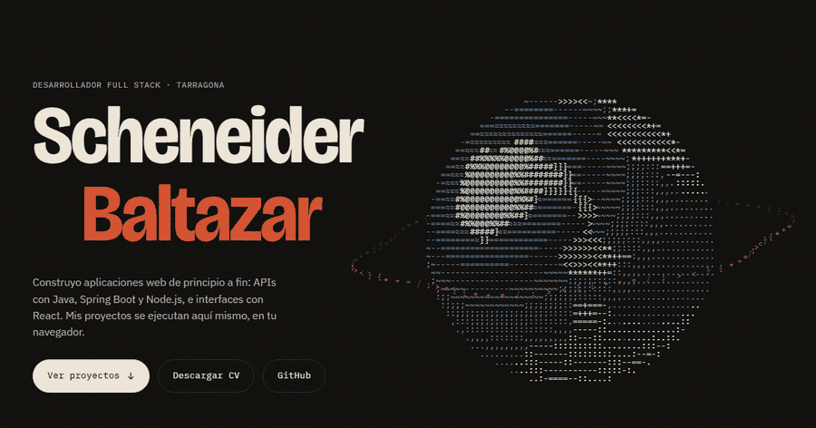

  

  

  
  
  
  

---

### 🌐 Mi portfolio: los proyectos se ejecutan en tu navegador

  

  Nada de capturas: en <a href="https://scheneiderbz.pages.dev/?ref=github"><b>scheneiderbz.pages.dev</b></a> juegas a mi Tetris en Java, usas el gestor en Python con SQLite y repartes cartas en un BlackJack escrito en COBOL, todo dentro de la página. 
  <a href="https://scheneiderbz.pages.dev/?ref=github"><b>Entrar al portfolio →</b></a>

---

### 🧑‍💻 Sobre mí

Desarrollador **Full Stack junior**. Trabajo sobre todo con **Java y Spring Boot** en el backend y con **React** en el frontend, y uso Python cuando hay algo que automatizar.

Antes de programar fui **ilustrador digital**. Por eso me importa tanto que el código funcione bien como que la interfaz se entienda.

- 🏆 **2.º puesto en el [Hackathon Tarragona 2025](https://github.com/FerdisJ/HackaTON)**: en un equipo de cuatro hicimos una solución con IA para agilizar trámites del Ajuntament, con modelos en local (Ollama) para que funcionara en un ordenador normal.
- 🎓 **Desenvolupament Web FullStack amb Java** (576 h, Fundación Esplai) · **Java SE 11 Programming II** (La Salle)
- ☁️ **Microsoft Azure Fundamentals**: AZ-900 · AI-900 · DP-900 · SC-900
- 🎯 Busco mi **primer puesto como desarrollador junior**.

---

### 🛠️ Tecnologías

  

---

### 🚀 Proyectos destacados

| | Proyecto | Qué es | Tecnologías |
|:-:|---|---|---|
| 🪐 | [**Portfolio_BZ**](https://github.com/AldairBZ/Portfolio_BZ) · [**web**](https://scheneiderbz.pages.dev/?ref=github) | Mi portfolio: Java, Python y COBOL ejecutándose en el navegador, en tres idiomas y con 48 pruebas en CI | React · TypeScript · Cloudflare · Vitest · Playwright |
| 🎮 | [**TetrisGame**](https://github.com/AldairBZ/TetrisGame) | Tetris de escritorio con ranking en MySQL, tests y CI | Java · Swing · MySQL · JUnit · Maven |
| 🃏 | [**BlackJack en COBOL**](https://github.com/AldairBZ/BlackJack-Proyecto-COBOL) | El motor del juego en COBOL y la interfaz en Python, comunicados mediante archivos | COBOL · Python · Tkinter |
| 🥐 | [**Gestor Bon Gust**](https://github.com/AldairBZ/GestorBonGustProject) | Inventario para una panadería: productos y movimientos de stock | Python · SQLite |
| 🧟 | [**Resident Evil Fan Web**](https://github.com/AldairBZ/A2_ResidentEvil_Web) · [**demo**](https://aldairbz.github.io/A2_ResidentEvil_Web/) | Web de 4 páginas, responsive y con animaciones | HTML5 · CSS3 |
| 🌍 | [**LifeLevelUp**](https://github.com/AldairBZ/LifeLevelUp) · [**demo**](https://lifelevelup.08-pruebas.workers.dev) | Proyecto final del bootcamp: mejora tus hábitos como en un videojuego, con logros, comunidad y un asistente con IA | React · Node.js · Express · MongoDB · JWT · OAuth |

---

### 🔥 Actividad

  

  

